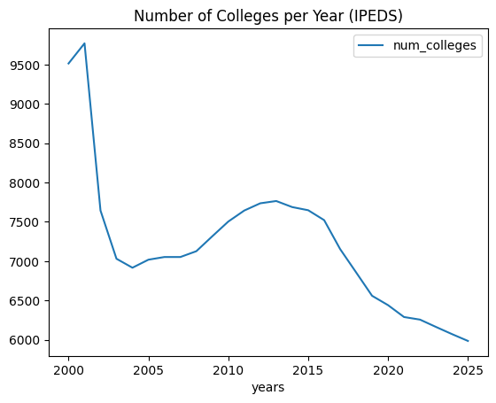

# Resume Model-V3

## Data
In order to develop an effective model for resume generation and evaluation, we perform exploratory data analysis (EDA) to determine what makes a good resume.

To determine this we decided to utilize college career services websites as our primary ground truth. To find and extract information from these sources, we used [IPEDS](https://nces.ed.gov/ipeds/) to find the root url affiliated with postsecondary institutions. We observed **10,594** unique colleges with unique web addresses over the years 2020 to 2025. You can see below the number of unique colleges surveyed by year. The reduction in number of colleges seen in the graph can be attributed to numerous reasons including but not limited to: Title IV Elgiblity Changes, Methods of Reporting, and Consolidation of Colleges.

