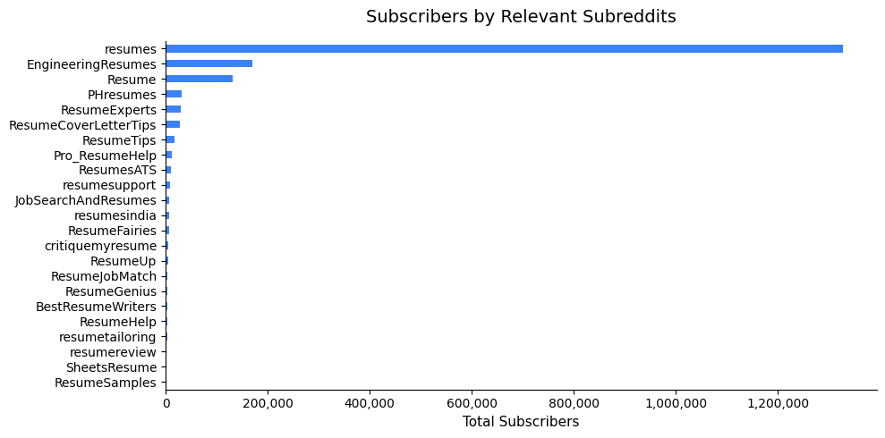

# Resume Model-V3
What constitutes an 'effective' resume remains largely subjective and governed by anecdotal heuristics rather than empirical evidence. Furthermore, strict privacy regulations (e.g., GDPR, PII compliance) and corporate liability prevent real-world applicant tracking datasets from being made public. To overcome this data bottleneck, this study leverages crowdsourced data from major resume-focused Reddit communities to empirically analyze community feedback, isolate recurring structural defects, and quantify the presentation features that drive resume efficacy.

## Methodology
To perform this analysis, we first wanted to identify the largest relevant subreddits related to our topic of resumes. Utilizing the [PRAW](https://praw.readthedocs.io/en/stable/), we pulled the top 100 subreddits for the search term "resume". This snapshot of results can be seen in [data](data/subs_df_snapshot_11_11_2026.csv).

47% of the subreddits contained the relevant search term "resume" (ignoring case). This cohort was then refined further to include communities of a significant size (median subscriber count >= **1091**). The cohort of relevant subreddits (n=23) we decided to investigate can be seen below:

We then got **10,183** posts in the largest subreddit (r/resumes) dating back to May 14, 2026. This was confined to a small time window due to this being a very active subreddit. We then performed preliminary exploratory data analysis (EDA) on this cohort to determine which posts we need to focus on going forward for the purpose of our study.

